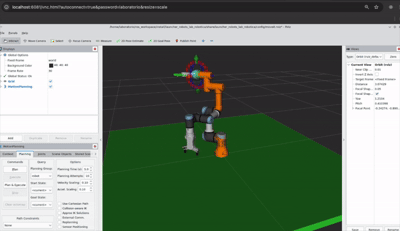

# Robótica y automatización inteligente - Práctica 1
**Autores**

| Nombre | Correo | GitHub |
| --- | --- | --- |
| Katherine Lorenzo | katherine.lorenzo@opendeusto.es | [@klorenzoe](https://github.com/klorenzoe) |
| Mauro Cornejo | maurorodrigo.cornejo@opendeusto.es | [@Maux112](https://github.com/Maux112) |



Antes de empezar hay que tener el build de practica1_msgs (para que sea importable), hacer estos pasos (dentro del container de ROS):

**1 - preparar el msgs**
```bash
cd ~/ros_workspace
colcon build --symlink-install
source ~/ros_workspace/install/setup.bash
ros2 interface show practica1_msgs/msg/EstadoCinematico
```

**2 - Preparar la terminal que escucha**
```bash
source /opt/ros/jazzy/setup.bash
source ~/ros_workspace/install/setup.bash
ros2 topic echo /estado_cinematico practica1_msgs/msg/EstadoCinematico
```

**3 - Correr el script** (ejecutar esto en otra terminal sin cerrar la que escucha)
```bash
python ~/ros_workspace/src/practica1/practica1/trayectorias_joint_states.py
```

## Parte 1: Requisitos mínimos

Para probar parte 1:
```bash
python trayectorias_joint_states.py
```

Notas importantes:
- Crear un suscriptor en ROS 2: `src/practica1/practica1/suscriptor_articulaciones.py`
- Ejecutar multiples trayectorias: `src/practica1/practica1/trayectorias_joint_states.py`
  - Trayectoria 1: `trayectoria_joint()`
  - Trayectoria 2: `trayectoria_lineal()`
  - Trayectoria 3: `trayectoria_circular()`
- Procesar Datos:
  - El suscriptor se encarga de registrar todas las muestras de posicion, velocidades y tiempo
  - Se calcula la aceleración y velocidad de la muestra
  - Se proceden a guardar en un CSV

## Parte 2: Retos Opcionales

Notas importantes:
- Mensaje ROS 2 personalizado: `src/practica1/practica1_msgs`
  - Se creo el mensaje con el siguiente comando dentro de practica1
    ```bash
    ros2 pkg create practica1_msgs --build-type ament_cmake --dependencies rosidl_default_generators std_msgs
    ```
  - Se editó para expotar los datos con el formato que se necesitaba:
    `src/practica1/msg/msg/EstadoCinematico.msg`

- Ingesta inteligente:
  - Para la ingesta se añadió en la parte del suscriptor un una verificación de la velocidad y se estableció un umbral donde se considera que ya no hay movimiento para registrar. El umbral UMBRAL_VELOCIDAD_PARADO se usa para discernir si es un movimiento registrable o no, de manera inteligente. Se usa un umbral porque hay ruido, la velocidad casi nunca sera 0.0
